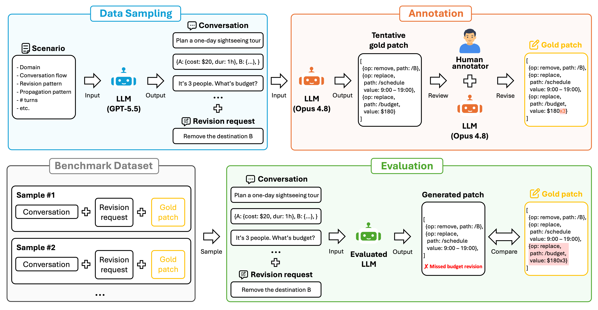

# [EMNLP 2026 Industry] What Else Needs Fixing? Exploring Cost-Effective Test-Time Compute for Revision Propagation in Artifacts Generated Through Conversation

<p align="center">
  <a href="https://ntt-dkiku.github.io/llm-revision-propagation" target="_blank"></a>
  <a href="https://aclanthology.org/2026.emnlp-industry.246/" target="_blank"></a>
  <a href="https://arxiv.org/abs/2609.03254" target="_blank"></a>
  <a href="https://alphaxiv.org/abs/2609.03254" target="_blank"></a>
  <a href="https://github.com/ntt-dkiku/llm-revision-propagation/blob/main/resources/EMNLP2026_Ind-885_poster.pdf" target="_blank"></a>
  <a href="https://github.com/ntt-dkiku/llm-revision-propagation/blob/main/resources/emnlp2026_Ind-885_slides_v2.pdf" target="_blank"></a>
</p>

This repo is the official implementation of "<a href="https://aclanthology.org/2026.emnlp-industry.246/" target="_blank">What Else Needs Fixing? Exploring Cost-Effective Test-Time Compute for Revision Propagation in Artifacts Generated Through Conversation</a>" (EMNLP 2026 Industry Track).
In this paper, we propose **RevPropBench**, a benchmark for evaluating the ability of LLMs to propagate revisions across dependent elements in conversationally generated JSON artifacts when users specify only a local change.
We also explore cost-effective test-time compute for this setting.

<p align="center">
  
  Overview of RevPropBench. The upper half shows the benchmark construction process, while the lower
half shows the evaluation process. Samples are generated via LLM-based synthetic sampling and human annotation.
</p>

## 📖 Table of contents

- [Reproducing the results](#-reproducing-the-results)
  - [0. Requirements](#0-requirements)
  - [1. Clone this repository](#1-clone-this-repository)
  - [2. Set your API keys in the .env file](#2-set-your-api-keys-in-the-env-file)
  - [3. Build the dataset](#3-build-the-dataset)
  - [4. Deploy local models](#4-deploy-local-models)
  - [5. Evaluation](#5-evaluation)
  - [6. Visualization](#6-visualization)
- [Benchmark extension](#-benchmark-extension)
- [Bug report and questions](#-bug-report-and-questions)
- [License](#-license)
- [Citation](#-citation)

## 🧪 Reproducing the results
In this section, we describe how to reproduce the experimental results presented in the paper.
The steps you need depend on what you want to reproduce:

- **Everything from scratch** (including both data generation and evaluation): steps 1 → 2 → 3 → 4 → 5 → 6.2
- **Evaluation only** (using the provided dataset): steps 1 → 2 → 4 → 5 → 6.2
- **Visualization only** (using the provided evaluation outputs): steps 1 → 6.1 → 6.2

> [!WARNING]
> Due to the nondeterministic nature of LLMs, rerunning the data generation and evaluation from scratch may not produce exactly the same results.
> To exactly reproduce the figures and other results reported in the paper, please use our provided outputs.

### 0. Requirements

- Docker (with Compose)
- NVIDIA Container Toolkit
- Make
- NVIDIA GPUs

### 1. Clone this repository
Clone this repository and navigate into the project directory.

```bash
git clone https://github.com/ntt-dkiku/llm-revision-propagation.git
cd llm-revision-propagation
```
### 2. Set your API keys in the `.env` file
Create your .env file and add your API keys.
```bash
cp docker/.env.example docker/.env
```

### 3. Build the dataset
The annotated dataset (150 cases: 50 scenarios × 3 artifact sizes) is already
in [benchmark/data/annotated/](./benchmark/data/annotated/), so skip this to use it as-is.
If you want to create the dataset from scratch, follow the steps below.

#### 3.1. Generate samples
Generate the raw samples by the following command.
```bash
make dataset DATASET_LEAVES="10 50 100"
```
> [!NOTE]
> GPT-5.5 is used by default for data generation, but you can change the model by setting `DATASET_MODEL`, for example, `DATASET_MODEL=openai/gpt-5.4-mini`.


#### 3.2. Annotation
Launch the annotation GUI by the following command.
```bash
make annotator-up
```
Then, access http://localhost:5001 in your browser and annotate each sample.

### 4. Deploy local models
Start a local vLLM server and check that it responds.
```bash
make vllm-up MODEL=<model>
make smoke-llm
```
`<model>` can be one of the five local models used in the paper: `gpt-oss-20b`, `gpt-oss-120b`, `qwen3.5-9b`, `qwen3.5-27b`, and `qwen3.5-122b-a10b`. Each is served with the same settings as in the paper.

> [!NOTE]
> All models except `qwen3.5-122b-a10b` run on GPU 0 by default. Select other GPUs by passing `VLLM_GPUS`, for example, `make vllm-up MODEL=<model> VLLM_GPUS=1`. `qwen3.5-122b-a10b` uses tensor parallelism across four GPUs by default (i.e., `VLLM_GPUS=0,1,2,3`). To serve any other local model, set the `VLLM_*` values in `docker/.env` and run `make vllm-up` without `MODEL`.

### 5. Evaluation
First, split the 150 annotated cases into the dev (30) and test (120) splits:
```bash
make split-dataset
```

Then, evaluate one model with one seed on the 120-case test split.
Results are written to `results/bench/final/seed<seed>-<model>/`, where the figure scripts in step 6 pick them up.
```bash
make bench-eval MODEL=<model> BENCH_SEED=<seed>
```
To reproduce the paper results, run this command for every combination of the six models (`gpt-oss-20b`, `gpt-oss-120b`, `qwen3.5-9b`, `qwen3.5-27b`, `qwen3.5-122b-a10b`, and `gpt-5.4-mini`) and the five seeds (`0`, `42`, `84`, `126`, `168`).


### 6. Visualization

#### 6.1. Extract cached results (Optional)
To use the evaluation outputs used in the paper, extract our archives in [results/paper_runs/](./results/paper_runs/) before running `make figures`:

```bash
make extract-paper-runs
```

#### 6.2. Output figures
Generate the paper figures into `results/figures/`:

```bash
make figures
```

## 🔧 Benchmark extension
RevPropBench can be extended along three axes.

### Scenarios and domains
Add a `Skeleton` entry in [benchmark/skeleton.py](./benchmark/skeleton.py). A skeleton declares a cascade scenario in natural language (conversation, edit, and propagation patterns). For example:

```python
# benchmark/skeleton.py
FITNESS_PLAN: list[Skeleton] = [
    Skeleton(
        theme="Changing the weekly session count",
        conversation_pattern="Center the artifact on a training plan with a weekly session count, where the total weekly training time and the weekly calorie estimate derive from that count by stated per-session values, so the count alone determines them. Around this core, add realistic, independent details a trainee would record.",
        edit_pattern="Change the weekly session count to a specific new number.",
        cascade_pattern="The total weekly training time and the weekly calorie estimate re-scale as the stated per-session values times the new count, so the new count uniquely fixes them. The per-session values and independent details stay unchanged.",
        requires_master_data=False,
    ),
]

SKELETONS_BY_DOMAIN: dict[str, list[Skeleton]] = {
    # ... existing domains ...
    "fitness_plan": FITNESS_PLAN,
}

_CATEGORY_BY_THEME: dict[str, Category] = {
    # ... existing themes ...
    "Changing the weekly session count": "arithmetic",
}
```

Then generate samples for it and annotate them as in step 3:

```bash
make dataset DATASET_DOMAIN=fitness_plan DATASET_LEAVES="10 50 100"
make annotator-up
```

### Revision methods
Implement a `RevisionMethod` subclass whose `prepare` returns the messages sent to the evaluated LLM (see [methods/common.py](./methods/common.py) for the interface). For example:

```python
# methods/my_method.py
from typing import Any, ClassVar

from methods.common import MethodInputs, RevisionMethod
from methods.subagent_revision import SUBAGENT_SYSTEM, build_subagent_user


class MyMethod(RevisionMethod):
    name: ClassVar[str] = "my_method"

    async def prepare(self, case: dict[str, Any], *, model: str | None,
                      temperature: float, retries: int,
                      seed: int | None = None) -> MethodInputs:
        # `case` carries the conversation (case["conversation"]), the current
        # artifact (case["current_json"]), and the requested edit.
        user = build_subagent_user(
            case, include_history=True, include_json=True,
            ref_text="<any auxiliary context your method adds>")
        return MethodInputs(messages=[
            {"role": "system", "content": SUBAGENT_SYSTEM},
            {"role": "user", "content": user},
        ])
```

Register it in `_CLASSES` in [methods/registry.py](./methods/registry.py):

```python
from methods.my_method import MyMethod

_CLASSES: list[type[RevisionMethod]] = [
    # ... existing methods ...
    MyMethod,
]
```

It then becomes selectable in step 5: `make bench-eval MODEL=<model> BENCH_METHODS=my_method`.
To implement a multi-call method (like SELECT), see [methods/subagent_consensus.py](./methods/subagent_consensus.py) for working examples.

### Models
To evaluate a new commercial model, pass its name (with the provider prefix) as `MODEL`, for example, `make bench-eval MODEL=anthropic/claude-sonnet-5`.

To evaluate a new local model, first serve it, then evaluate it with the `VLLM_SERVED_NAME` value you set:

```bash
# serve: set the VLLM_* values in docker/.env beforehand
make vllm-up
# evaluate
make bench-eval MODEL=<VLLM_SERVED_NAME value> BENCH_SEED=<seed>
```

## 🐞 Bug report and questions
If you encounter bugs or have any questions, please post issues or discussions in this repo. New feature requests are also welcome.

## 📄 License
Our code is licensed by NTT. The use of our code is limited to research purposes. See [LICENSE](./LICENSE.md) for details.

## 🤝 Citation
If you find this work useful, please cite our paper as follows:
```
@inproceedings{kikuta-2026-else,
    title = "What Else Needs Fixing? Exploring Cost-Effective Test-Time Compute for Revision Propagation in Artifacts Generated Through Conversation",
    author = "Kikuta, Daisuke",
    editor = "Atanasova, Pepa  and
      Haffari, Gholamreza  and
      Wang, Minghan",
    booktitle = "Proceedings of the 2026 Conference on Empirical Methods in Natural Language Processing: Industry Track",
    month = oct,
    year = "2026",
    address = "Budapest, Hungary",
    publisher = "Association for Computational Linguistics",
    url = "https://aclanthology.org/2026.emnlp-industry.246/",
    pages = "4161--4177",
    ISBN = "979-8-89176-460-6",
    abstract = "Large Language Models (LLMs) often help users generate artifacts through iterative cycles of generation and revision in conversation. A challenge here is that, when users specify only a local change during revision, LLMs must instead identify the relevant dependencies and propagate the revision to all affected parts of the artifact. This paper studies this ability of LLMs on conversationally generated artifacts, where the artifact context and its dependencies may be embedded in the conversation history. Toward practical use, we also explore cost-effective test-time compute for this new setting. Specifically, we introduce a new benchmark for this setting, and evaluate nine revision methods, including sequential reflection and parallel sampling variants, using gpt-oss-20b/120b, gpt-5.4-mini, and qwen3.5-9b/27b/122b on the benchmark. The results show that baselines achieve accuracies of 68.3{--}93{\%}, and the most cost-effective method is selecting from three parallel samples using either LLM-based or medoid selection, which improves accuracy by 2.2{--}9.7{\%}. Our code and dataset are available at https://github.com/ntt-dkiku/llm-revision-propagation."
}
```
